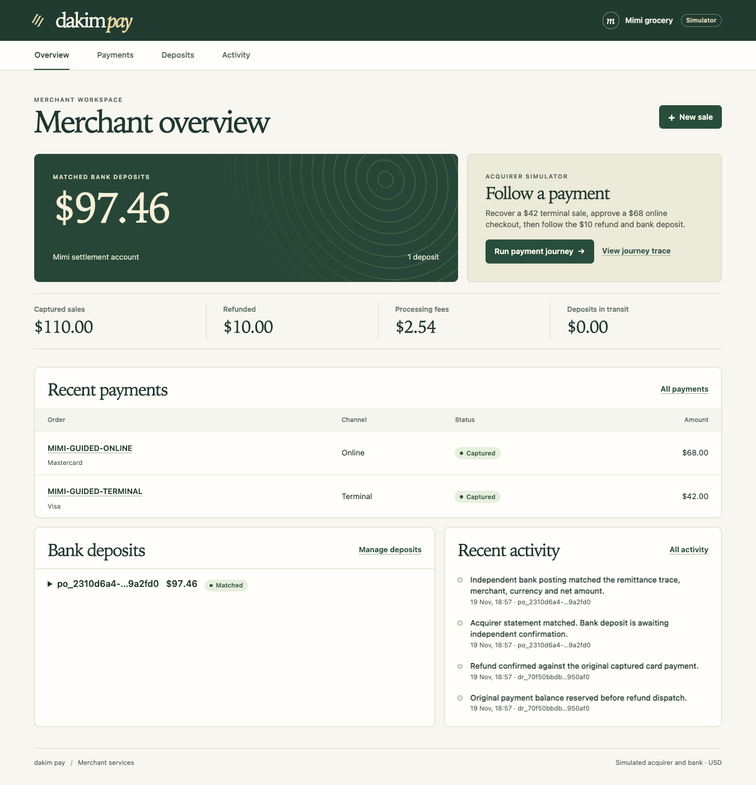

# dakim pay

dakim pay is a standalone merchant payment app. Its first merchant is Mimi grocery. An attended terminal sale and a hosted online sale pass through a local acquirer simulator and an independent bank simulator. No real cards, credentials or funds are needed.



## Run the app

On macOS or Linux, install Go 1.25 or later, Python 3.9 or later, and PostgreSQL server/client tools (verified with PostgreSQL 18). Run the launcher as your ordinary OS user. Set `DAKIM_PG_BIN` to the PostgreSQL bin directory if the tools are outside the normal installation paths.

```sh
git clone https://github.com/seejovin/dakimpay.git
cd dakimpay
./scripts/local start
```

Open [dakim pay](http://127.0.0.1:8460) on the machine that runs it. Choose **Run payment journey**, then **View journey trace**. Replaying the journey reuses the original order, refund, payout and bank references. It remains separate from practice sales. Use `./scripts/local status`, `restart` or `stop` to manage the services. The launcher keeps its private keys, databases and logs outside the repository under `~/.local/share/dakim-pay`. An alternate `DAKIM_STATE_DIR` and distinct ports create a separate installation.

The [recorded Mimi payment journey](docs/mimi-payment-journey.md) includes both charge references, the original refund, the payout and the independently observed bank posting.

## How payment emulation works

| What happens | What the app actually checks |
|---|---|
| Mimi starts a **$42.00 terminal sale** on MIMI-01 using a synthetic Visa instrument. | The acquirer commits the capture and closes the HTTP connection before returning a response. dakim pay records an unknown outcome. Checking the original operation recovers the capture without issuing a second debit. |
| Mimi starts a **$68.00 online sale** using a synthetic Mastercard. | The acquirer creates a capability URL on its own origin. In manual checkout the buyer approves the sale there. The guided journey supplies the simulated buyer approval. dakim pay checks the acquirer’s original status. |
| Mimi requests a **$10.00 refund**. | The acquirer records it against the original online charge. The service reserves refundable value during processing. Replaying the original request returns the same refund. |
| The acquirer prepares the payout. | The itemized remittance contains captures of $42.00 and $68.00, a $10.00 refund and fees of $0.84 and $1.70. Its $97.46 transfer instruction enters the bank’s pending records. |
| The bank posts to Mimi. | The bank writes its own entry. dakim pay matches merchant, currency, net and bank trace before displaying **Matched**. Re-importing a statement or checking the bank again has one financial effect. |

The local fee schedule is deliberately simple. Terminal captures cost 2%, online captures 2.5%, rounded half up to cents. A later refund can produce a negative remittance. These are simulation terms. The simulator’s “approved” button substitutes for a cardholder, issuer and network response. It does not perform EMV cryptography, card authentication or interbank settlement.

**To operate it manually**, choose **New sale**, channel, amount and test brand. Select the lost-response option for a terminal sale, then open the payment and choose **Recover payment**. For an online sale use **Open hosted checkout**, approve in the separate tab and check the payment. Issue a partial refund from the captured payment. In **Deposits**, create the payout and try reconciling before posting the bank entry. It stays in transit. Post the simulated bank entry, reconcile again and download the matched Mimi statement. If the buyer closes the hosted tab after approving, a durable worker looks up the original payment in the background. The operator can use Visa, Mastercard and American Express test instruments in either channel.

## Connecting the actual Mimi POS

The dakim pay console can run by itself. A compatible Mimi checkout can also run as a separately installed merchant using its normal register, returns, finance and sign-in screens. The base adapter patch targets Mimi revision `e3186a9`. The finance patches add classification and independent correction review to that adapter. For a clean checkout use the sequence below. The adjacent development checkout already includes these changes.

```sh
# From the dakim pay directory, with the Mimi source in ../mimi
git -C ../mimi apply --check "$PWD/integrations/mimi-simulator.patch"
git -C ../mimi apply "$PWD/integrations/mimi-simulator.patch"
git -C ../mimi apply --check "$PWD/integrations/mimi-finance-reporting.patch"
git -C ../mimi apply "$PWD/integrations/mimi-finance-reporting.patch"
git -C ../mimi apply --check "$PWD/integrations/mimi-finance-corrections.patch"
git -C ../mimi apply "$PWD/integrations/mimi-finance-corrections.patch"
../mimi/scripts/mimi-dakim start
```

Open [the dedicated Mimi training register](http://127.0.0.1:8379). Its local-only sign-in file is inside `~/.local/share/dakim-pay/mimi-merchant/`. The merchant API credential is issued solely for this simulation. The normal till on port 8377 has its own installation. The staffed Lane 1 adapter deliberately loses each original terminal capture reply. The payment worker recovers it using its original merchant key. Refunds retain the original dakim pay payment ID. The online storefront in this build is represented by the merchant checkout flow in the dakim pay console.

The integration test buys two grocery items through the real Mimi register API and requests a return through its original receipt. Approval by a second operator triggers the original-card refund. Mimi finance then imports the bank-confirmed statement and another staff member closes it. [Mimi adapter patch](integrations/mimi-simulator.patch) · [Cross-application acceptance test](scripts/verify-mimi)

## Service and credential boundaries

| Process | Default origin | Durable records and authority |
|---|---|---|
| dakim pay | 127.0.0.1:8460 | Merchant operations, idempotency keys, observations, financial matching and operator UI. |
| Acquirer simulator | 127.0.0.1:8461 | Independent captures, original-card refunds, buyer approvals, statement items and payment instructions to the simulated bank. |
| Bank simulator | 127.0.0.1:8462 | Independent pending instructions and posted entries with unique traces. An ordinary payment-service credential cannot post a bank entry. |

Each process owns a separate PostgreSQL database in a private local cluster. The launcher generates distinct merchant, service, bank-instruction, buyer-approval and bank-post credentials and a private console cookie. Merchant requests cannot operate the training bank or submit an operator payout. The local console also acts as a **simulation controller**, with separate credentials for the artificial buyer and bank operator. This is a single-user loopback installation. Local OS access is its operator trust boundary. A production deployment needs independent hosts/identities, merchant onboarding, staff authentication and authorization, partner security validation, real statements, backups and operating coverage. The simulator has no live mode.

The simulated acquirer and dakim pay share a dedicated notification-signing key. **Activity → Processor notifications** shows whether dakim pay verified each original transaction and flags conflicting deliveries. A payment marked **Awaiting capture** stays on hold. [Recovery procedures, tested amounts and outstanding release gates](docs/callback-recovery-checkpoint.md)

If a capture is refunded before Mimi issues the receipt, the register checks the original charge, every refund and the acquirer's dispute observation. Operations records custody and finance verifies the full amount before the carton goes to quarantine. The cross-application exercise follows the resulting seven-cent debit into Mimi's books. [Receiptless refund checkpoint](docs/receiptless-refund-checkpoint.md) · [Stripe, WeChat Pay and Alipay benchmarks](docs/provider-benchmarks.md)

When the acquirer initiates a refund after Mimi has deposited the sale proceeds, finance receives a separate exception and reconciles the later debit. The original receipt and matched deposit stay intact. [Post-receipt refund checkpoint and run evidence](docs/post-receipt-refund-checkpoint.md)

In Mimi **Reports → Provider refunds after sale**, finance can document a merchant-funded service concession on a matched later debit. A different reviewer can approve that version or return it with a reason. Finance can submit corrected evidence while preserving the original proposal and return decision. The reporting record links the receipt, original deposit and later debit. The bank and suspense journals retain their posted values. [Finance workflow](docs/finance-classification.md) · [Correction and replay evidence](docs/finance-corrections.md)

Each captured payment shows the successful refunds, amount reserved for pending requests and amount still available. [Refund reservation rules, concurrency and upgrade evidence](docs/refund-reservations.md)

Finance can compare the processor’s capture-time fee estimate with each fee on a frozen statement in **Deposits → Compare fees**, including when a payout is held for review. [Itemized fee comparison and verified bank example](docs/fee-variance.md)

In **Deposits → Open timing queue**, finance can find processor payouts awaiting a bank posting, bank postings without a processor payout, and source matches. Record a complete observation to preserve when the report first learned each payout, bank posting and local booking. Replay with separate effective and knowledge cutoffs. [Timing queue](docs/settlement-timing.md) · [What finance knew at shift close](docs/settlement-knowledge.md)

## Verify it

```sh
./scripts/verify
MIMI_SOURCE=../mimi ./scripts/verify-mimi --settlement-regression
```

The first script starts a disposable three-service installation, exercises the hosted checkout, restarts the services with an unresolved charge, checks replay and the partial refund, holds an unposted deposit, then matches the bank and merchant export. It also tests all six brand and channel combinations and guided replay. The second script requires the patched Mimi checkout and starts an additional disposable Mimi installation. Both scripts stop their processes and remove their own temporary data.

For additional concurrent refund, recovery and statement-validation tests, set `DAKIM_TEST_DATABASE_URL` to an administrative connection on a disposable PostgreSQL cluster and run `go test -race -count=1 ./...`. These tests create and drop their own randomly named databases. Without this setting, database acceptance tests skip. See the [network acceptance guide](docs/network-acceptance.md) and [company design](DESIGN.md) for the path from simulation to a contracted pilot.
