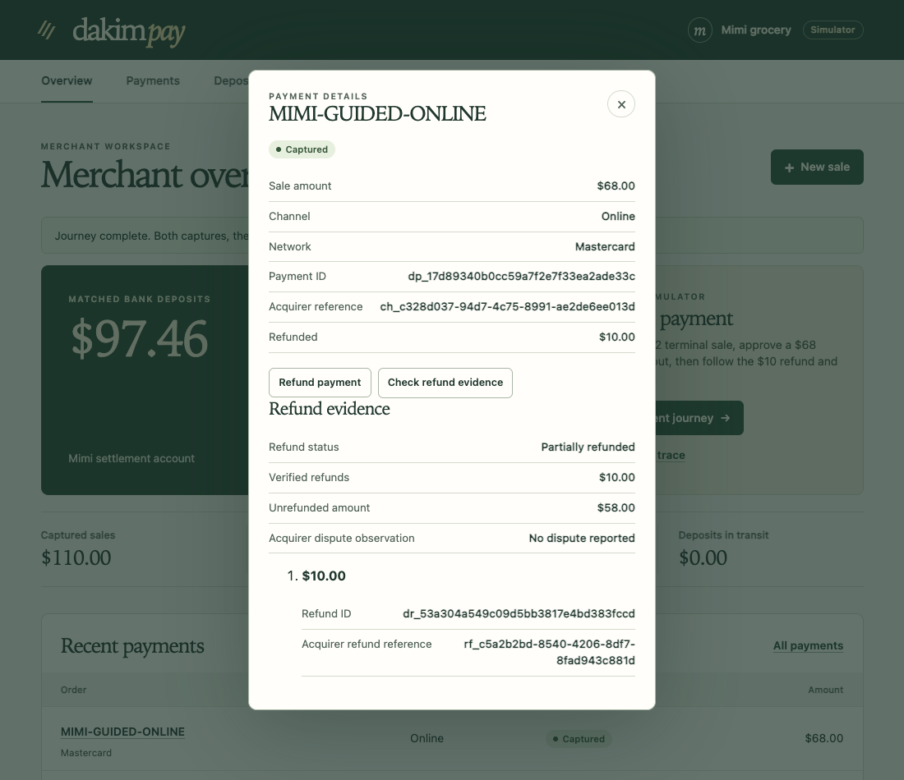

# Mimi refund before receipt

19 November 2026 · Local, synthetic USD · Separate dakim pay and Mimi processes

**Decision.** A captured terminal payment can already have an unresolved refund when Mimi first sees the capture. Mimi now checks the original payment and itemized refund evidence before issuing its receipt. If the entire card amount came back before the sale completed, the store can account for the real card movements and quarantine the goods without creating a grocery sale. This addresses the first exposure in the [provider comparison and ranked backlog](provider-benchmarks.md).

## Evidence contract

`GET /v1/payments/{id}/reversal-evidence` uses the existing merchant credential. dakim pay reads the acquirer's original charge, recorded dispute observation and refund list from one database snapshot. It then checks all local refund reservations in a second snapshot. A reservation committed while the remote read was in flight is included. Neither read initiates a charge, refund, cancellation or payout.

| Observation | Merchant action |
|---|---|
| Matching merchant, original order, lane, amount, currency, captured status and reference. Complete empty refund list and an explicit clean dispute observation. | Mimi can issue one retail receipt. The observation is valid at the time of the check. |
| Either side is missing a refund, records disagree, a refund is pending, the source is unavailable, or clean dispute evidence is missing. | Keep the sale, stock and any tender reservations held. Retry the original lookup. An open dispute requires review. A pre-upgrade charge with no dispute observation stays unknown. |
| Some money returned. | Record the custody observation and retain the goods and claims. Finance can inspect the history again. A partial refund cannot release a fully reversed order. |
| Every linked refund succeeded, the amounts add up to the original capture, and the charge is undisputed. | A supervisor or owner records physical custody. A different authorized finance reviewer approves. Mimi verifies the source again, records the original capture and each refund, quarantines the observed lot, and releases the basket reservations. |

HTTP 200 carries a complete itemization with an explicit dispute observation. An open or unknown observation confers no clearance. HTTP 409 indicates incomplete or inconsistent evidence, including more than 512 refund legs in this version. HTTP 502 indicates unavailable or unreadable source evidence. The payment ID and each dakim pay refund ID match the references in Mimi's settlement export. Each refund also identifies its acquirer reference and original charge. [Service endpoint](../internal/pay/reversal_evidence.go) · [Acquirer snapshot](../internal/simulator/reversal_evidence.go)

In **Payments**, open a captured sale and select **Check refund evidence**. The operator can see the capture reference, individual refunds, remaining amount and source dispute observation. Unavailable or inconsistent evidence leaves a visible hold with a recheck. Chrome exercised a $68 sale with $10 and $58 refunds, a $42 sale with zero refunds, and switching payments while a result was still in flight. [Operator view](../web/app.js)

## Verified economic result

1. Mimi reserved one carton of eggs and submitted a **$3.60** terminal sale. The acquirer captured it and lost the reply. A disposable test fixture delayed just the original till inspection. All charges, refunds, decisions, settlement and bank postings used the normal application entry points.
2. The dakim pay operator issued a **$1.20** refund. The till saw the reversal and held the carton. The person who recorded custody was refused finance approval. Finance attempted verification. The partial refund left the basket, stock claim and receipt count unchanged. The held amount and its original reference survived a payment-service restart.
3. A second refund for **$2.40** exhausted the original amount. Both refund requests were replayed under their respective keys. An extra cent was refused. Independent finance approval and a successful recheck released the basket. One carton from the original lot moved to quarantine. Mimi issued **zero retail receipts** for this basket.
4. Finance matched three gross lines to the merchant statement using their exact references. The acquirer retained its **$0.07** fee. The bank had to post a **$0.07 debit** before export. Mimi recorded **−7 cents bank, +7 cents fees** and applied all three movements. Reconciliation replay produced zero additional matches. [Executable shift](../scripts/mimi_reversal_check.py)

The ordinary register return still produced a $3.46 deposit and a balanced journal. The separate terminal and hosted-checkout journey still produced $97.46. Database tests cover a stale source read while a refund commits, a missing or misbound leg, an unresolved local reservation, malformed evidence and the migration from a charge with no dispute observation. [Provider and merchant evidence tests](../internal/pay/reversal_evidence_test.go) · [Previous recovery checkpoint](callback-recovery-checkpoint.md)

Both Go applications passed their PostgreSQL-backed race suites, static checks and dependency verification. Mimi's 20,000-SKU browser run, passkey and continuity drills also passed. A disposable restore matched all 78 table fingerprints. The browser and database runs used synthetic stores. A real merchant, wallet, reader or bank did not participate.

## Reproduce and continue

From the dakim pay checkout run `./scripts/verify` and `MIMI_SOURCE=../mimi ./scripts/verify-mimi`. Each allocates its own temporary installations. For PostgreSQL regression runs set `DAKIM_TEST_DATABASE_URL` in dakim pay and `MIMI_TEST_DATABASE_URL` in Mimi to a disposable administrative connection, then run `go test -race -count=1 ./...` in each repository. The database tests skip without their respective settings. The [Mimi companion patch](../integrations/mimi-simulator.patch) targets a clean checkout of Mimi revision `e3186a9`.

**Boundary.** The two refunds above were external to the till and recorded by dakim pay. A refund known only to the acquirer is held for investigation. A clean observation also cannot rule out a new adjustment after it was read. Disputes that clear without a full refund, post-receipt account adjustments and returned bank transfers still need explicit workflows. Real-partner tests, reader or wallet qualification, merchant approval and independent live-bank evidence remain outstanding.

**Next checkpoint.** Simulate one refund initiated by the acquirer after Mimi has already issued its receipt and reconciled its first deposit. Persist the source refund and original capture references, match the dated adjustment to a later statement, and show Mimi finance a single exception. Acceptance requires repeated and out-of-order notices to create one adjustment, the sale and first bank entry to retain their history, and a second, independently posted bank debit to clear the adjustment once. Keep unresolved inventory or tax decisions assigned to the merchant.

The subsequent [post-receipt refund checkpoint](post-receipt-refund-checkpoint.md) follows this case through Mimi's books.
